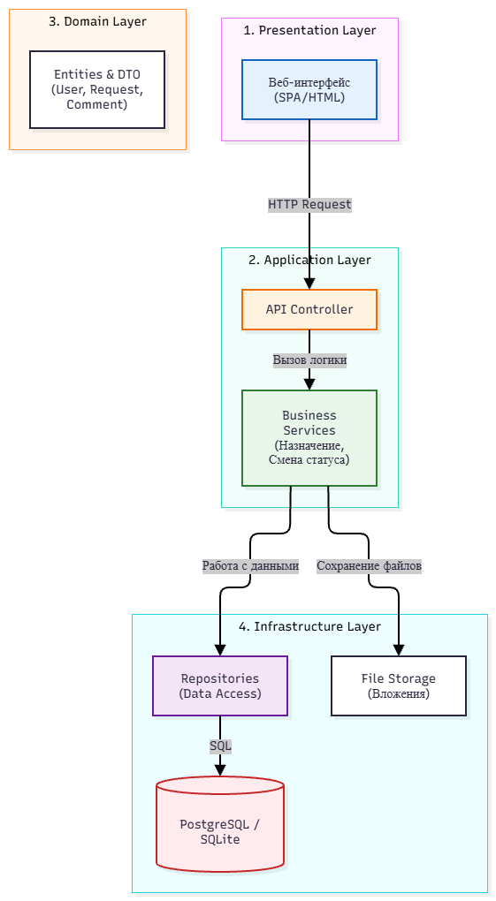
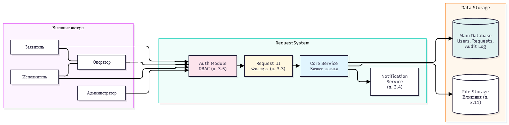
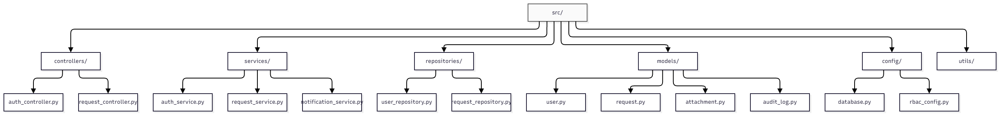
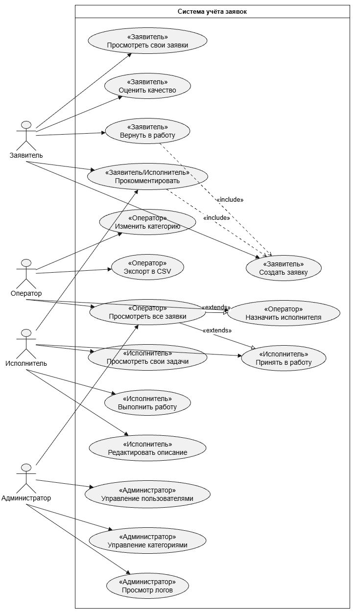

# Архитектура программного продукта RequestSystem

## 1. Выбранный архитектурный стиль и обоснование

Для проекта «Система учёта заявок» выбрана **слоистая архитектура (Layered Architecture)**. 
В качестве основного паттерна используется разделение на уровни: `Controller → Service → Repository → Database`.

**Почему выбран именно этот вариант:**
- **Разделение ответственности (Separation of Concerns):** Бизнес-логика (правила смены статусов, назначение исполнителя) отделена от работы с базой данных и от интерфейса. Это позволяет менять СУБД или фреймворк без переписывания всей системы.
- **Тестируемость:** Слой бизнес-логики (`Service`) можно легко покрыть unit-тестами, подменяя слой базы данных (`Repository`) на «заглушки» (mocks).
- **Сопровождаемость:** Код становится понятнее и проще в поддержке. Новый разработчик быстро поймёт, где искать логику создания заявки, а где — SQL-запросы.
- **Соответствие стеку:** Идеально ложится на фреймворк FastAPI (Python) и реляционную БД PostgreSQL, указанные в `README.md` и `docs/TZ.md`.

## 2. Связь с существующими артефактами проекта

Архитектурное решение опирается на материалы, уже созданные в репозитории:
- **`docs/TZ.md`** — определяет роли, функциональные и нефункциональные требования, которые напрямую влияют на границы слоёв (например, RBAC реализуется на уровне `Service`, а аудит — через `Repository`).
- **`docs/architecture/`** — содержит исходные диаграммы (drawio), которые детализируют данный документ.
- **`docs/sql/`** — содержит SQL-скрипты (`schema.sql`, `seed.sql`, `queries.sql`), которые являются физической реализацией слоя `Database` и репозиториев.

## 3. Логические слои системы

Система разделена на 4 логических слоя. Для каждого слоя строго определена зона ответственности и установлены запреты на выполнение чужой работы.

| Слой | Ответственность | Что слой делать НЕ должен |
| :--- | :--- | :--- |
| **1. Presentation / Controller** | Принимает HTTP-запросы, валидирует входные данные (Pydantic), вызывает методы сервисов, формирует HTTP-ответы (JSON, коды 200/400/404). | Не должен содержать SQL-запросы. Не должен содержать бизнес-логику (например, проверку прав доступа или правил смены статуса). |
| **2. Service (Бизнес-логика)** | Реализует бизнес-правила (например, «Заявитель может закрыть заявку только из статуса Выполнена», «Исполнитель видит только назначенные на него заявки»), координирует работу нескольких репозиториев, управляет транзакциями. | Не должен принимать HTTP-запросы и работать с `Request`/`Response` объектами. Не должен писать SQL-запросы напрямую. |
| **3. Repository (Data Access)** | Инкапсулирует работу с базой данных. Выполняет CRUD-операции (создание, чтение, обновление, удаление) с использованием ORM (SQLAlchemy). | Не должен принимать бизнес-решения (например, не может решать, можно ли удалить заявку). Не должен знать о HTTP-статусах. |
| **4. Database (PostgreSQL)** | Хранит данные, обеспечивает целостность (внешние ключи, ограничения NOT NULL/UNIQUE), выполняет сложные SQL-запросы (см. `docs/sql/schema.sql`). | Не должна содержать UI-логику или программный код бизнес-правил (хранимые процедуры не используются для бизнес-логики). |

## 4. Основные модули системы

Внутри слоёв код сгруппирован по предметным модулям, которые соответствуют сущностям из `docs/TZ.md`:
- **Users (Пользователи):** управление учётными записями, ролями (Заявитель, Исполнитель, Оператор, Администратор).
- **Requests (Заявки):** создание, редактирование, просмотр и назначение заявок.
- **Statuses (Статусы):** управление жизненным циклом заявки (Новая, В работе, Выполнена, Закрыта).
- **Categories (Категории):** справочник категорий (включая иерархию `parent_id`).
- **Comments (Комментарии):** обсуждение заявок между заявителем и исполнителем.
- **Audit Log (История изменений):** запись всех изменений статуса и исполнителя (требование из `TZ.md`).

## 5. Ключевые классы и модули

Ниже приведено описание 4 ключевых классов для слоя работы с заявками:

1. **`RequestController` (Слой Controller)**
   - *Назначение:* Обработка HTTP-запросов по эндпоинтам `/api/v1/requests`.
   - *Входные данные:* JSON-объект из HTTP-запроса (тема, описание, категория), ID пользователя из токена авторизации.
   - *Результат:* HTTP-ответ (JSON с данными созданной/изменённой заявки и соответствующий HTTP-код).

2. **`RequestService` (Слой Service)**
   - *Назначение:* Реализация бизнес-логики работы с заявками (создание, назначение исполнителя, смена статуса с проверкой прав).
   - *Входные данные:* DTO (Data Transfer Object) с данными заявки, ID текущего пользователя.
   - *Результат:* Объект бизнес-сущности `Request` (или выброс исключения `BusinessLogicError`, если действие запрещено).

3. **`RequestRepository` (Слой Repository)**
   - *Назначение:* Изоляция запросов к базе данных для таблицы заявок.
   - *Входные данные:* ID заявки, фильтры для поиска (например, статус, категория, исполнитель).
   - *Результат:* Экземпляр ORM-модели `Request` из базы данных (или `None`, если не найдено).

4. **`StatusTransitionService` (Слой Service)**
   - *Назначение:* Управление конечным автоматом статусов. Проверяет, имеет ли право конкретная роль перевести заявку из статуса «Новая» в «В работе» (на основе правил из `TZ.md`).
   - *Входные данные:* Текущий статус заявки, желаемый новый статус, роль пользователя.
   - *Результат:* Логическое значение (`True`/`False`) или выброс исключения о недопустимом переходе.

## 6. Структура каталогов исходного кода

Для реализации выбранной архитектуры используется следующая структура папки `src/`:

	```text
	src/
	├── controllers/      #Слой представления (роутеры FastAPI)
	│   ├── request_router.py
	│   └── user_router.py
	├── services/         #Слой бизнес-логики
	│   ├── request_service.py
	│   └── user_service.py
	├── repositories/     #Слой доступа к данным
	│   ├── request_repository.py
	│   └── user_repository.py
	├── models/           #ORM-модели (SQLAlchemy) и схемы валидации (Pydantic)
	│   ├── orm.py
	│   └── schemas.py
	├── database/         #Подключение к БД, сессии
	│   └── session.py
	└── main.py           #Точка входа в приложение
	```

## 7. Связь с SQL-скриптами

Физическая структура базы данных, описанная в `docs/sql/schema.sql`, полностью соответствует слою `Database` и используется репозиториями. 

Например, при выборке заявок с фильтрацией по статусу, `RequestRepository` будет обращаться к таблицам `Requests` и `Statuses`, созданным в этом скрипте. Тестовые данные из `seed.sql` используются для проверки работы слоев `Service` и `Repository` на этапе разработки и тестирования.

## 8. Визуализация архитектуры

### 8.1. Слоистая архитектура
Схема разделения системы на логические слои и потоки данных между ними:



### 8.2. Диаграмма компонентов
Схема взаимодействия внешних акторов, модулей системы и хранилищ данных:



### 8.3. Структура каталогов исходного кода
Детальная схема файловой структуры проекта:



### 8.4. Диаграмма вариантов использования (Use Case)
Диаграмма ролей и сценариев работы с системой:

