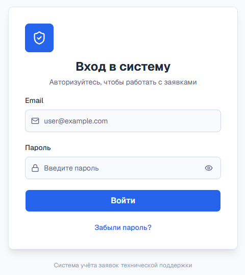
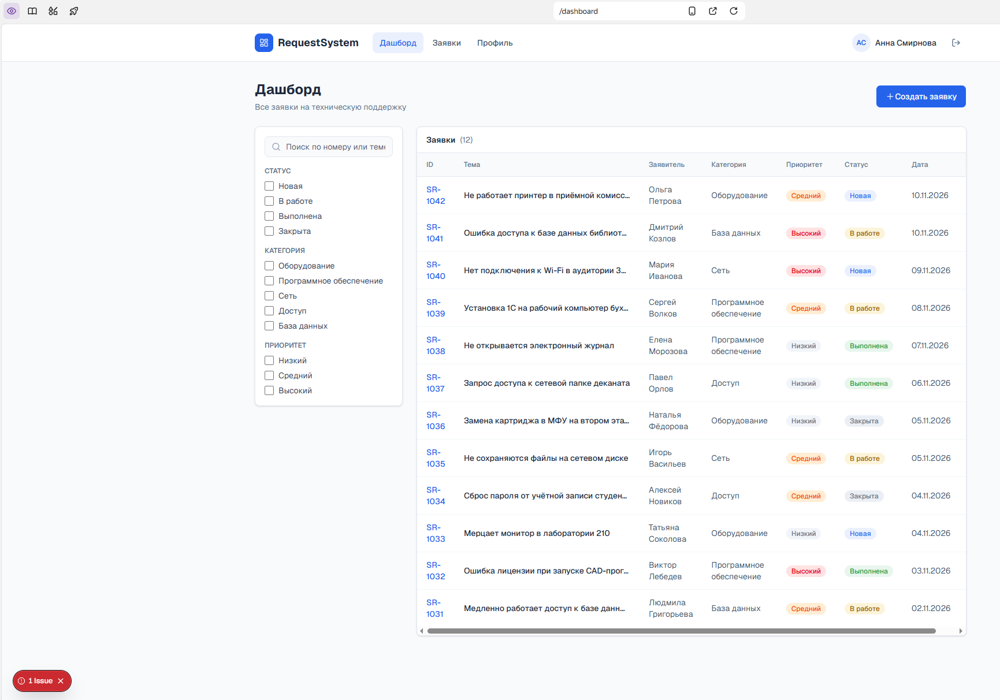
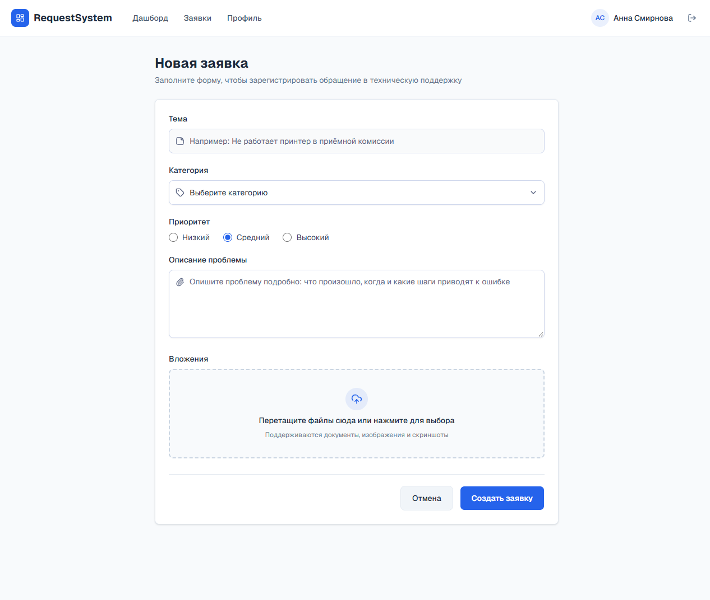
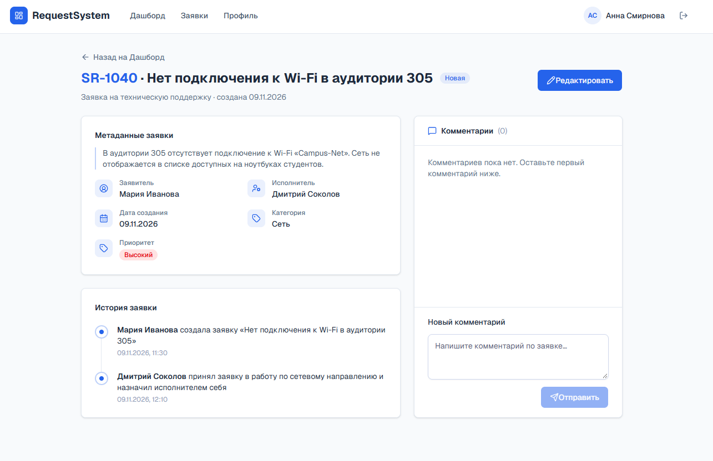
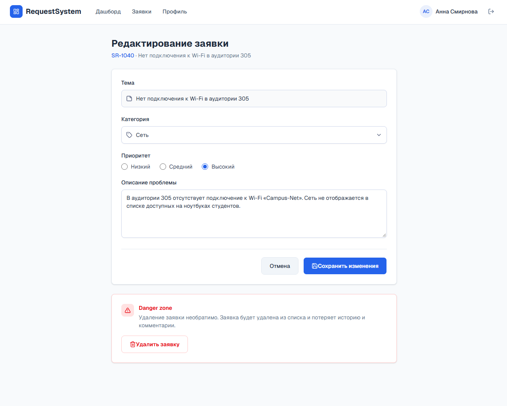

# Прототип пользовательского интерфейса RequestSystem

Прототип разработан с использованием нейросети **Яндекс Vibecraft** на основе структурированного технического задания. Прототип представляет собой интерактивное веб-приложение, состоящее из 5 связанных экранов, выполненное в едином стиле SaaS-продукта.

## 1. Экран авторизации (01_login)
**Назначение:** Вход пользователей в систему.
**Доступные действия:** Ввод email и пароля, переключение видимости пароля (иконка глаза), восстановление пароля, вход в систему.

## 2. Главный экран / Дашборд (02_dashboard)
**Назначение:** Просмотр списка заявок и навигация по системе.
**Доступные действия:** Поиск, фильтрация по статусу, категории и приоритету, переход к созданию заявки, открытие карточки заявки.

## 3. Экран создания заявки (03_create_ticket)
**Назначение:** Регистрация нового обращения.
**Доступные действия:** Заполнение темы, выбор категории и приоритета, ввод описания, прикрепление файлов (drag-and-drop), сохранение или отмена.

## 4. Карточка заявки / Детали (04_ticket_details)
**Назначение:** Просмотр полной информации по заявке.
**Доступные действия:** Просмотр истории изменений (Audit Log), чтение вложений, добавление комментария, возврат к списку или переход к редактированию.

## 5. Экран редактирования (05_edit_ticket)
**Назначение:** Изменение параметров существующей заявки или её удаление.
**Доступные действия:** Редактирование полей, сохранение, удаление заявки (через Danger zone и модальное окно подтверждения).

